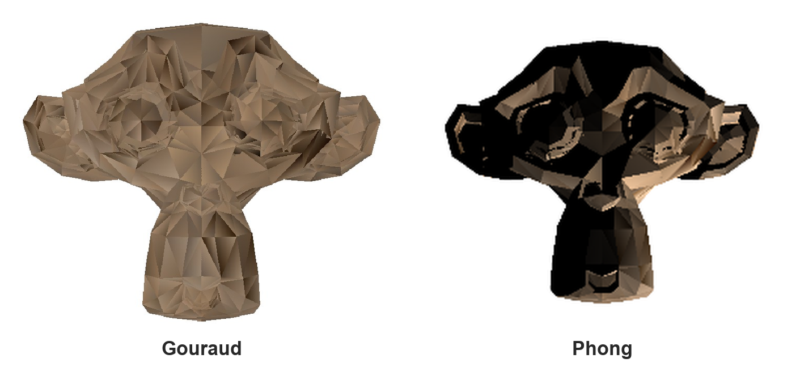
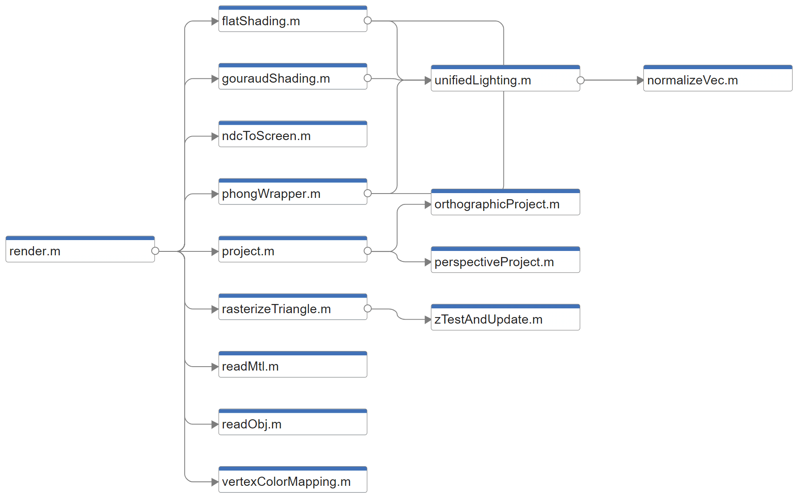

# Z-Buffer Rasterizers in CUDA and MATLAB

Two implementations of triangle rasterization and depth testing. The C++/CUDA implementation assigns one GPU thread to each output pixel. The MATLAB implementation shows the full software rasterization pipeline in separate, readable modules.

## CUDA rasterizer

The host loads an OBJ model, rotates and projects it into screen space, and calculates flat Lambertian shading per face. Each GPU thread tests its pixel against the triangles using barycentric coordinates, interpolates depth, and selects the closest visible fragment. Each thread writes its own pixel.

- Minimal OBJ loader and 24-bit BMP output.
- Separate coverage, depth interpolation, and visibility calculations.
- Reports the mean time over six runs, including kernel execution and device-to-host copying.

### Build and run

Use CMake with a CUDA-capable compiler. Run these commands from the repository root.

```sh
cd cuda
cmake -S . -B build
cmake --build build --config Release
```

From `cuda/`, run the executable so its default asset paths resolve. A single-configuration CMake build typically places it in `build/`. A Visual Studio Release build typically places it in `build/Release/`.

```sh
./build/renderer
./build/renderer assets/cube.obj 1280 720 cube.bmp
```

The default run loads `assets/monkey.obj`, renders at 1024 × 1024, and writes `render.bmp`. To compile directly from `cuda/`, use `nvcc -O2 src/renderer.cu -o renderer`.

An earlier CUDA Z-buffer prototype averaged approximately **10.44 ms** over six runs on an NVIDIA RTX 4060 Laptop GPU. The CUDA program in this repository is a reimplementation of that prototype. Run its benchmark to measure performance for the current code, GPU, scene, and resolution.

## MATLAB rasterizer

The MATLAB pipeline loads OBJ and MTL data, transforms and projects geometry, rasterizes triangles, applies a Z-buffer depth test, and shades the visible result.

- Perspective and orthographic projection, with normalized device coordinates mapped to the screen.
- Flat, Gouraud, and Blinn–Phong shading.
- Per-vertex color mapping from supported `map_Kd` texture data.

From the `matlab/` directory, run `main`. The entries near the top of [matlab/main.m](matlab/main.m) set the model, shading method, camera, and lighting. [matlab/render.m](matlab/render.m) coordinates the pipeline.





## License and credits

The sample Suzanne and cube models come from Blender. See the [MIT License](LICENSE) for the project code.
